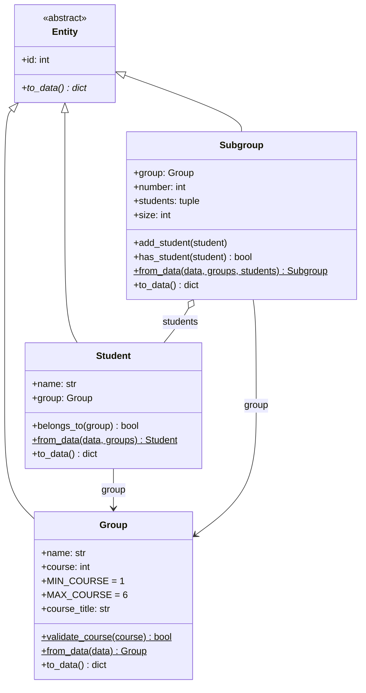

# Сервис формирования учебных подгрупп

Приложение для деления учебных групп на подгруппы (например, для
лабораторных работ и занятий по иностранному языку). Консольная версия
(ПР1–ПР3) дополнена веб-интерфейсом на Django (ПР5), который построен на
системе шаблонов Django (ПР6).

## Быстрый старт

Нужен Python 3.10+ (проверено на 3.13). В PowerShell из папки проекта:

```powershell
python -m venv .venv
.venv\Scripts\activate
pip install -r requirements.txt
python manage.py migrate
python manage.py runserver
```

Открыть в браузере: <http://127.0.0.1:8000/>. Остановить сервер: `Ctrl+C`.

Если PowerShell запрещает активацию окружения, выполните один раз
`Set-ExecutionPolicy -Scope CurrentUser RemoteSigned` или запускайте без
активации: `.venv\Scripts\python.exe manage.py runserver`.

В проекте уже есть демо-данные (2 группы, 35 студентов, 3 подгруппы).
Добавлять группы и студентов и формировать подгруппы можно в консольной
версии: `python main.py` (изменения сразу видны в браузере после
обновления страницы). Тесты и проверка стиля: `pytest -v` и `flake8 .`.

## 1. Назначение

Сервис рассчитывает необходимое число подгрупп, их размеры, формирует
подгруппы и показывает, в какую подгруппу попадает каждый студент.

Приложение позволяет:

- просматривать в браузере группы, студентов и подгруппы;
- открывать карточку группы, студента и подгруппы по её номеру;
- видеть, разделена ли группа на подгруппы и кто в какую подгруппу входит;
- в консольной версии: добавлять группы и студентов, искать группы, отбирать
  группы по курсу, рассчитывать разбиение, формировать и расформировывать
  подгруппы, определять подгруппу студента;
- хранить данные между запусками (JSON).

## 2. Используемые технологии

- Python 3.10+;
- Django 5.2 (LTS) и Django Template Language (DTL);
- HTML5, CSS3, JavaScript;
- Bootstrap 5.3 (CDN) и собственные стили проекта;
- JSON для хранения данных;
- pytest, flake8.

## 3. Целевая аудитория

- сотрудники деканата и учебного отдела, формирующие расписание;
- преподаватели и кураторы групп;
- студенты, которым нужно узнать свою подгруппу.

## 4. Предметная область

Организация учебного процесса в вузе. Учебный план задаёт курсы; на каждом
курсе обучаются группы; студенты группы делятся на подгруппы ограниченного
размера (по вместимости лаборатории, требованиям к занятию и т.п.).

Правила предметной области:

- студент входит ровно в одну группу, группа относится к одному курсу (1–6);
- подгруппы группы формируются один раз: повторное формирование без
  расформирования запрещено;
- размеры подгрупп отличаются не более чем на одного студента, остаток
  достаётся первым подгруппам;
- студент попадает только в подгруппу своей группы;
- при изменении состава группы её подгруппы расформировываются.

Студенты в группе нумеруются в алфавитном порядке (как в журнале) и
распределяются по подгруппам последовательно.

## 5. Основные сущности

Сущности — классы пакета `models` (ПР3). Курс не выделен в отдельный класс:
у него нет собственного состояния и поведения, это проверяемый атрибут
группы (`Group.course`, `Group.validate_course()`).



| Класс | Назначение | Атрибуты | Методы |
|-------|------------|----------|--------|
| `Entity` | абстрактный базовый класс сущностей | `id` | `to_data()` (абстрактный), `__repr__()` |
| `Group` | учебная группа курса | `name`, `course`, `course_title`; атрибуты класса `MIN_COURSE`, `MAX_COURSE` | `validate_course()` (`@staticmethod`), `from_data()` (`@classmethod`), `to_data()`, `__str__()` |
| `Student` | студент группы | `name`, `group` (объект `Group`) | `belongs_to()`, `from_data()`, `to_data()`, `__str__()` |
| `Subgroup` | подгруппа со списком студентов | `group`, `number`, `students`, `size` | `add_student()`, `has_student()`, `from_data()`, `to_data()`, `__str__()` |

Принципы ООП: **инкапсуляция** (защищённые атрибуты, `@property`, сеттеры
с проверкой, `id` и `group` только для чтения), **наследование** (`Group`,
`Student`, `Subgroup` от `Entity`), **полиморфизм** (`to_data()` и
`__str__()` переопределены в каждом классе), **композиция** (`Student`
хранит `Group`, `Subgroup` — `Group` и `Student`).

Декоратор `@handle_errors` (`utils.py`, с `functools.wraps`) превращает
`ValueError` в действиях консольного меню в понятное сообщение.

## 6. Веб-интерфейс

Веб-часть реализована на Django. Страницы формируются из данных
`data/*.json` через классы ПР3 и отображаются Django-шаблонами. HTML в
Python-коде представлений не формируется, а функция `page()` из ПР5
удалена: view-функции готовят данные и передают их в шаблоны через контекст
(`render(request, шаблон, context)`).

| URL | Имя маршрута | View-функция | Шаблон |
|-----|--------------|--------------|--------|
| `/` | `homepage:index` | `homepage.views.index()` | `homepage/index.html` |
| `/groups/` | `groups:list` | `groups.views.groups()` | `groups/group_list.html` |
| `/groups/<int:group_id>/` | `groups:detail` | `groups.views.group_detail()` | `groups/group_detail.html` |
| `/students/` | `students:list` | `students.views.students()` | `students/student_list.html` |
| `/students/<int:student_id>/` | `students:detail` | `students.views.student_detail()` | `students/student_detail.html` |
| `/subgroups/` | `subgroups:list` | `subgroups.views.subgroups()` | `subgroups/subgroup_list.html` |
| `/subgroups/<int:subgroup_id>/` | `subgroups:detail` | `subgroups.views.subgroup_detail()` | `subgroups/subgroup_detail.html` |
| `/admin/` | — | встроенная админ-зона Django | — |

Если объект с указанным номером не найден, view передаёт в шаблон `None`
и возвращает страницу с кодом **404** (`status=404 if obj is None else 200`),
а сообщение «не найдено» выводит шаблон через `/`.
Адрес, которому не нашлось маршрута (`/nonexistent/`), обрабатывает
`handler404` (`homepage.views.page_not_found()`, шаблон `templates/404.html`),
объявленный в корневом `urls.py` один раз для всех приложений. Конвертер
`<int:...>` пропускает только целые числа: `/groups/abc/` не вызовет view.

```text
браузер → GET /groups/1/
        → subgroup_service/urls.py: path("groups/", include("groups.urls"))
        → groups/urls.py:           path("<int:group_id>/", group_detail)
        → groups.views.group_detail(request, group_id=1)
              load_all() → find_group_by_id() → context
        → render(request, "groups/group_detail.html", context)
        → шаблон наследует base.html → HTML-страница (200 или 404)
```

Схема представления: **View → Context → Template → HTML**. Источник
данных не изменился: JSON-файлы и объекты `Group`, `Student`, `Subgroup`.

## 7. Django Template Language

### Базовый шаблон и наследование

`templates/base.html` содержит общую структуру страницы: `<head>`,
подключение Bootstrap и собственного CSS, шапку с логотипом, навигацию,
контейнер, подвал и скрипт. Дочерние шаблоны наследуют его через
`` и переопределяют блоки:

```django
Группы – Подгруппы
...
```

### Включаемые шаблоны (``)

| Шаблон | Назначение | Где подключается |
|--------|------------|------------------|
| `templates/includes/navigation.html` | навигация (подсветка текущего раздела по `request.resolver_match.namespace`) | `base.html` |
| `groups/includes/group_card.html` | карточка группы | `group_list.html` |
| `subgroups/includes/split_status.html` | бейдж «разделена / не разделена» | карточка группы, `group_detail.html` |
| `subgroups/includes/subgroup_card.html` | карточка подгруппы | `subgroup_list.html` |
| `students/includes/student_row.html` | строка таблицы студентов | `student_list.html` |

Данные во включаемый шаблон передаются явно:
``.

### Контекст, циклы и условия

View передаёт словарь контекста, например для `/groups/`:
`{"items": [{"group": ..., "students_count": 25, "is_split": True}, ...]}`,
а шаблон выводит его через `{{ ... }}` и ``.
Пустые коллекции обрабатываются через ``; состояния
(«разделена», «не распределён», «не найдено») — через ``.
Бизнес-логика (подсчёт студентов, поиск подгруппы, проверка статуса) остаётся
в Python, шаблон только отображает готовые значения.
Значения из JSON экранируются автоматически.

### Фильтры

- `{{ items|length }}`, `{{ students|length }}` — количество элементов;
- `{{ group.name|default:"Без названия" }}` — значение по умолчанию;
- `{{ today|date:"d.m.Y" }}` — форматирование даты на главной странице.

### Именованные URL и пространства имён

В `urls.py` каждого приложения задан `app_name` (`homepage`, `groups`,
`students`, `subgroups`) и имена маршрутов `list` / `detail` / `index`.
Ссылки в шаблонах строятся тегом ``:
``, ``;
жёстко заданных адресов в шаблонах нет.

### Статические файлы

Каталог `homepage/static/homepage/`:

- `css/style.css` — собственные стили (цвета бренда, шапка, карточки, блок
  `hero`, плитки статистики, подвал);
- `js/main.js` — подставляет текущий год в подвал;
- `img/logo.svg` — логотип (также значок вкладки).

В шаблонах: `` и ``.
Bootstrap 5.3 подключён из CDN для базовой вёрстки, собственный CSS его
дополняет. При `DEBUG = False` встроенный сервер разработки не раздаёт
статику (на рабочем сервере её обслуживает веб-сервер), поэтому проверка
страницы 404 в этом режиме выглядит без собственных стилей.

## 8. Структура проекта

```text
.
├── manage.py                 запуск команд Django
├── subgroup_service/         конфигурация Django-проекта
│   ├── settings.py           настройки (INSTALLED_APPS, TEMPLATES, DEBUG)
│   ├── urls.py               маршруты верхнего уровня, handler404
│   ├── asgi.py
│   └── wsgi.py
├── templates/                шаблоны уровня проекта
│   ├── base.html
│   ├── 404.html
│   └── includes/navigation.html
├── homepage/
│   ├── static/homepage/      css/style.css, js/main.js, img/logo.svg
│   ├── templates/homepage/   index.html
│   ├── urls.py, views.py
├── groups/
│   ├── templates/groups/     group_list.html, group_detail.html,
│   │                         includes/group_card.html
│   ├── urls.py, views.py
├── students/
│   ├── templates/students/   student_list.html, student_detail.html,
│   │                         includes/student_row.html
│   ├── urls.py, views.py
├── subgroups/
│   ├── templates/subgroups/  subgroup_list.html, subgroup_detail.html,
│   │                         includes/split_status.html,
│   │                         includes/subgroup_card.html
│   ├── urls.py, views.py
│   (в каждом приложении также apps.py, models.py, admin.py,
│    tests.py, migrations/)
├── models/                   классы предметной области (ПР3)
│   ├── base.py               Entity, generate_id()
│   ├── groups.py             Group и функции работы с группами
│   ├── students.py           Student и функции работы со студентами
│   └── subgroups.py          Subgroup, расчёт и формирование подгрупп
├── storage.py                JSON <-> объекты, load_all()
├── utils.py                  учебный год, безопасный ввод, декоратор
├── main.py                   консольная версия (сохранена с ПР3)
├── data/                     groups.json, students.json, subgroups.json
├── tests/                    тесты pytest (модель, хранилище, веб)
├── requirements.txt
├── pytest.ini
└── .flake8
```

Пакет `models/` проекта (классы предметной области) не путать с файлами
`models.py` внутри Django-приложений: они пока пустые, Django-модели будут
созданы при переходе к ORM. Приложение для пользователей не создавалось:
пользователи появятся на этапе аутентификации через встроенную модель
`django.contrib.auth`. Шаблоны приложений лежат в
`<приложение>/templates/<приложение>/`: повторяющийся вложенный каталог
защищает от конфликтов имён между приложениями.

## 9. Назначение модулей

- `subgroup_service/` — настройки и корневая маршрутизация Django-проекта;
- `homepage/`, `groups/`, `students/`, `subgroups/` — view-функции,
  маршруты и шаблоны соответствующих разделов;
- `models/` — классы `Group`, `Student`, `Subgroup` и функции работы с
  коллекциями (`find_group_by_id()`, `get_group_students()`,
  `find_student_subgroup()`, `create_subgroups()` и др.);
- `storage.py` — загрузка и сохранение (`load_all()` читает все три файла и
  восстанавливает ссылки между объектами; используется консолью и вебом);
- `main.py` — консольное меню (добавление и формирование выполняется здесь);
- `tests/` — автоматизированные тесты.

## 10. Хранение данных

Данные хранятся в `data/` в виде списков словарей; связи записываются
номерами (`group_id`, `student_ids`). При загрузке номера превращаются в
ссылки на объекты, при сохранении объекты превращаются обратно в данные
через `to_data()`. Django ORM и база данных для данных проекта пока не
используются (`db.sqlite3` содержит только служебные таблицы Django).

```json
[{"id": 1, "name": "ИКБО-01-24", "course": 2}]
[{"id": 1, "name": "Абрамов А.С.", "group_id": 1}]
[{"id": 1, "group_id": 1, "number": 1, "student_ids": [1, 2, 3]}]
```

Файлы читаются заново при каждом запросе: изменения, сделанные в консоли,
сразу видны в браузере. Повреждённый файл не перезаписывается — консоль
сообщает об ошибке и завершается.

В демо-данных группа ИКБО-01-24 (25 студентов) уже разделена на 3 подгруппы
(9 + 8 + 8), группа ИВБО-02-23 (10 студентов) — нет.

## 11. Установка и запуск

```text
python -m venv .venv
.venv\Scripts\activate
pip install -r requirements.txt
python manage.py migrate
python manage.py check
python manage.py runserver
```

Открыть в браузере: <http://127.0.0.1:8000/>

Собственная страница 404 видна только при выключенной отладке:

```text
# PowerShell
$env:DJANGO_DEBUG = "0"; python manage.py runserver
# затем открыть http://127.0.0.1:8000/nonexistent/
```

Консольная версия (сохранена):

```text
python main.py
```

Проверка того, что Django видит статический файл:
`python manage.py findstatic homepage/css/style.css`.

## 12. Тестирование

```text
pytest -v
```

Тесты проверяют классы и правила предметной области, преобразование
JSON ↔ объекты, декоратор и ввод (ПР1–ПР3), а также веб-слой: маршруты с
пространствами имён, статус, используемый шаблон и контекст каждой
страницы, коды 404, `handler404`, пустые коллекции, автоэкранирование,
подсветку навигации, поиск статических файлов, отсутствие `page()` и HTML в
представлениях, компиляцию всех шаблонов и отсутствие жёстко заданных
ссылок. Для веб-тестов данные подменяются временными файлами.

## 13. Проверка качества кода

```text
flake8 .
```

Каталог `.venv` исключён в `.flake8`.

## 14. Зависимости

- `Django==5.2.*` — веб-фреймворк;
- `pytest` — автоматизированные тесты;
- `flake8` — проверка качества кода.

## 15. Текущее состояние и план развития

Реализовано:

- консольная версия, классы предметной области, JSON-хранилище (ПР1–ПР3);
- Django-проект и четыре приложения, маршрутизация двух уровней,
  обработка 404 (ПР5);
- шаблонный веб-интерфейс: `base.html`, наследование, блоки, `include`,
  контекст, циклы и условия, фильтры, именованные URL с пространствами
  имён, собственные CSS, JavaScript и изображение (ПР6).

Пока не реализовано: Django ORM и база данных для данных проекта (данные
хранятся в JSON), формы, создание и изменение данных в браузере
(формирование подгрупп, добавление групп и студентов доступны только в
консоли).

Планируется:

- перенос сущностей в Django ORM и подключение базы данных;
- формы создания и изменения данных;
- пользователи и разграничение доступа;
- разработка API;
- контейнеризация приложения;
- настройка CI/CD.
